  

**무거운 건 들어 올리고, 복잡한 건 풀어냅니다.**

프론트엔드에서 시작해 생성형 AI까지. 
무대 위에서 배운 꾸준함으로 코드를 씁니다.

 

<table align="center">
<tr>
<td valign="top">

### `CODE`

- **SPORTS - VISION AI**  · 현재
- **현대카드** · 챗봇 (2025.01.05 ~ 2026.10.23)
- **kakaotech bootcamp** · 생성형 AI 1,000시간 수료 (2024.07.01 ~ 2024.12.31)
- **오아시스비즈니스** · Frontend 인턴 5개월
- **덕성여자대학교** · 컴퓨터공학과 학사
- 정보처리기사 · 빅데이터분석기사 · SQLD

</td>
<td valign="top">

### `IRON`

- **웨이트랩 헬스장 1호점** · 부점장 · 트레이너 (2022.12.01 ~ 2024.01.31)
- **'23 WNGP** · Bikini Top 2
- **'23 NPC** · Bikini Top 3
- **'22 NPC** · Bikini Top 2 · Top 4
- **'22 NABBA** · Bikini Top 3
- 생활스포츠지도사 2급

</td>
</tr>
</table>

 

 

  

<!--

-->

